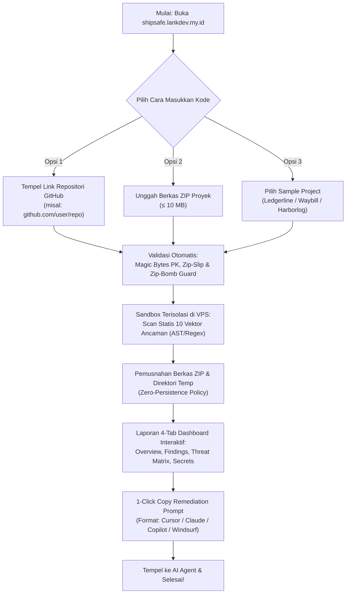

# 🛡️ ShipSafe — Dokumentasi Resmi & Spesifikasi Sistem

> **Production URL**: [https://shipsafe.lankdev.my.id](https://shipsafe.lankdev.my.id)  
> **Repository GitHub**: [github.com/gilank-dev/shipsafe](https://github.com/gilank-dev/shipsafe)  
> **Status Sistem**: Live & Production Ready (3-Tier Architecture)  
> **Kategori**: Pre-Deployment Security Gatekeeper untuk Vibe Coding & Web Applications  

---

## 📖 Daftar Isi
1. [Ringkasan Eksekutif & Latar Belakang](#1-ringkasan-eksekutif--latar-belakang)
2. [Fitur Utama & Alur Pengguna](#2-fitur-utama--alur-pengguna)
3. [Arsitektur Sistem (3-Tier Setup)](#3-arsitektur-sistem-3-tier-setup)
4. [Protokol Keamanan & Zero-Persistence Policy](#4-protokol-keamanan--zero-persistence-policy)
5. [Matriks 10 Vektor Ancaman (10-Threat Vectors)](#5-matriks-10-vektor-ancaman-10-threat-vectors)
6. [Engine Heuristik Presisi & Anti-False-Positive](#6-engine-heuristik-presisi--anti-false-positive)
7. [Struktur Dashboard Laporan (4-Tab Layout)](#7-struktur-dashboard-laporan-4-tab-layout)
8. [Spesifikasi Remediation Prompt per AI Agent](#8-spesifikasi-remediation-prompt-per-ai-agent)
9. [Hasil Benchmark Pengujian Nyata (Sample Ledgerline)](#9-hasil-benchmark-pengujian-nyata-sample-ledgerline)
10. [Referensi REST API Backend](#10-referensi-rest-api-backend)
11. [Model Bisnis & Skema Tiering](#11-model-bisnis--skema-tiering)
12. [Roadmap Pengembangan Masa Depan](#12-roadmap-pengembangan-masa-depan)

---

## 1. Ringkasan Eksekutif & Latar Belakang

Di era kecerdasan buatan, tren **vibe coding** memungkinkan siapa saja—dari pengembang solo, indie hacker, hingga tim startup—membangun aplikasi web fungsional dalam hitungan jam menggunakan coding agent seperti Cursor, Windsurf, atau Claude Code.

Namun, kecepatan pembuatan kode ini meninggalkan risiko keamanan kritis yang kerap terabaikan:
- **API Key & Secret Bocor**: Kredensial produksi (Stripe, AWS, JWT secrets, database connection string) tertanam langsung di kode sumber dan ikut terdorong ke repositori publik.
- **Konfigurasi Server & HTTP Longgar**: Kebijakan CORS terbuka (`origin: "*"` dengan credentials) dan ketiadaan security headers (`CSP`, `X-Frame-Options`).
- **Broken Access Control & Missing RLS**: Basis data tanpa Row Level Security (RLS) sehingga pengguna dapat membaca atau memodifikasi data penyewa lain cukup dengan mengubah parameter ID di URL.

### Mengapa Solusi yang Ada Belum Cukup?
- **Pentester Profesional**: Biaya mahal (jutaan hingga puluhan juta rupiah) dan proses lambat (hitungan hari/minggu), tidak terjangkau bagi vibe coder.
- **Tools SAST Konvensional (SonarQube, Snyk)**: Memerlukan konfigurasi pipeline CI/CD yang rumit, dan hasilnya berupa daftar panjang jargon keamanan pasif tanpa solusi perbaikan yang bisa langsung dieksekusi.

**ShipSafe** hadir sebagai jembatan: *pre-deployment security gatekeeper* yang memindai kode sumber secara statis dalam hitungan detik, menampilkan skor risiko dan lokasi celah, lalu secara instan membuatkan **Actionable Remediation Prompt 1-Klik** yang siap ditempel ke AI Coding Agent untuk memperbaiki kode secara presisi.

---

## 2. Fitur Utama & Alur Pengguna



### 2.1 Dual Source Ingestion (GitHub Link & ZIP Upload)
1. **Import GitHub Repo**: Pengguna cukup menyalin dan menempelkan URL repositori GitHub publik (`https://github.com/owner/repo` atau `owner/repo`). Tersedia tombol preset uji coba cepat: `gilank-dev/shipsafe` dan `expressjs/express`. Backend ShipSafe langsung mengambil arsip zipball dari GitHub API, memvalidasi magic bytes, dan memprosesnya tanpa pengguna harus mengunduh dan men-zip manual di komputernya.
2. **Upload ZIP**: Pengguna dapat mengunggah berkas arsip ZIP hingga ukuran 10 MB untuk proyek lokal yang belum di-push ke GitHub.
3. **Preset Proyek Contoh**: Dropdown *Load sample* menyediakan 3 template proyek siap uji:
   - **Ledgerline**: Invoicing SaaS (Next.js + Supabase + Stripe) dengan celah kritis untuk demonstrasi mitigasi.
   - **Waybill**: Internal dispatch tool di balik SSO perusahaan (profil risiko moderat).
   - **Harborlog**: Static docs site berbasis Astro (profil risiko rendah/info).

### 2.2 Mandatory Authentication Gate
Untuk mencegah penyalahgunaan antrean dan serangan DoS terhadap server:
- Pengguna wajib login menggunakan akun **GitHub OAuth**, **Google OAuth**, **Magic Link**, atau **Email/Password**.
- Sesi diamankan menggunakan enkripsi token JWT berbasis Clerk dan Supabase Auth.
- Setelah login, pengguna mendapatkan akses ke fitur riwayat audit (*History Modal*) untuk membuka kembali laporan sebelumnya.

### 2.3 High-Density Landing Page & Integrasi MCP Server
1. **Landing Page Resmi (Customs Desk)**: Tersedia di rute `/` dengan estetika *ink-on-ruled-paper*, menyajikan 10 bagian komprehensif: pengenalan, use case (Vibe coder, Indie Hacker, Engineering teams), protokol 3-detik, matriks 10 vektor ancaman, batasan jujur (*radical transparency* batas 10MB & SAST), transparansi harga developer, kontak langsung WhatsApp & Telegram admin, ulasan teknis, FAQ interaktif, serta akses instan ke konsol audit via tombol `Launch Console ->` (`/console`).
2. **ShipSafe MCP Server (`@shipsafe/mcp-server`)**: Server Model Context Protocol standar berbasis stdio JSON-RPC 2.0 di folder `mcp/` untuk integrasi native dengan Cursor, Claude Desktop, Windsurf, OpenCode, dan Hermes. Menyediakan tools `audit_codebase`, `get_threat_matrix`, `get_remediation_prompt`, dan `verify_fix`. Panduan konfigurasi lengkap tersedia di [`MCP.md`](file:///C:/Users/HYPE%20AMD/files/PROJECT/PERSONAL/ShipSafe/MCP.md).

---

## 3. Arsitektur Sistem (3-Tier Setup)

```
┌─────────────────────────────────────────────────────────────────┐
│                       TIER 1: FRONTEND                          │
│             Hosted on Vercel Edge (Global CDN)                  │
│             Domain: https://shipsafe.lankdev.my.id              │
│  • React 19 + TypeScript + Vite + Tailwind CSS v4               │
│  • Anti-Slop Design System (Typography: Archivo + IBM Plex Mono)│
│  • High-Density 4-Tab Report Dashboard & Responsive Sticky Rail │
│  • Bot Defense: Cloudflare Turnstile CAPTCHA (Bypass Option)   │
│  • State Management: Zustand dengan persistensi localStorage   │
└────────────────┬───────────────────────────────┬────────────────┘
                 │                               │
       Audit Request (REST/JSON)          Auth & History (RLS)
                 │                               │
                 ▼                               ▼
┌─────────────────────────────────┐   ┌───────────────────────────┐
│     TIER 2: BACKEND ENGINE      │   │  TIER 3: DATABASE & AUTH  │
│       CentOS 9 Stream VPS       │   │      Supabase Cloud       │
│  • Node.js 20 + Express + TS    │   │                           │
│  • Isolated /tmp Sandbox Engine │   │ • PostgreSQL Database     │
│  • Zip-Bomb & Zip-Slip Guards   │   │ • Row Level Security (RLS)│
│  • Static Rule Engine (SAST)    │   │ • Clerk & Supabase Auth   │
│  • Concurrency Queue Limiter    │   │ • Multi-tenant Isolation  │
│    (Max 3 concurrent processes, │   └───────────────────────────┘
│     kapasitas FIFO 25 antrean)  │
│  • 9Router AI Gateway Service   │
│    (Model: hermes-agent)        │
│    dengan auto-fallback statis  │
└─────────────────────────────────┘
```

---

## 4. Protokol Keamanan & Zero-Persistence Policy

ShipSafe dirancang dengan prinsip **Security by Design** dan **Zero Trust**:

| Parameter Proteksi | Spesifikasi & Batasan Teknis | Implementasi Kode |
|---|---|---|
| **Magic Bytes Validation** | Header biner file wajib `50 4B 03 04` (`PK\x03\x04`). Berkas biner palsu ditolak seketika. | `checkZipMagicBytes(buffer)` |
| **Batas Ukuran Upload** | Maksimal **10 MB** berkas terkompresi. | `MAX_ZIP_BYTES = 10 * 1024 * 1024` |
| **Batas Dekompresi (Zip-Bomb)** | Maksimal total hasil ekstraksi **100 MB**. | `MAX_DECOMPRESSED_BYTES = 100 MB` |
| **Rasio Kompresi Maksimal** | Maksimal rasio **100:1**. Arsip dengan rasio abnormal ditolak. | `MAX_COMPRESSION_RATIO = 100` |
| **Batas Jumlah Berkas** | Maksimal **5.000 file/entri** per arsip. | `MAX_ENTRIES = 5000` |
| **Batas Kedalaman Folder** | Maksimal kedalaman direktori **15 level**. | `MAX_DEPTH = 15` |
| **Zip-Slip & Path Traversal Guard** | Menolak berkas dengan karakter `..`, path root absolut (`/etc/`), atau Windows drive letter (`C:\`). | `validateAndExtractZip()` |
| **Zero-Execution Ban** | Kode pengguna **tidak pernah dijalankan, dipasang (npm install), atau dikompilasi**. Murni dianalisis secara statis (AST & regex). | Sandbox isolasi filesystem |
| **Zero-Persistence Policy** | Berkas ZIP dan folder sementara di `/tmp/shipsafe-*` langsung dimusnahkan seketika audit selesai lewat blok `finally { cleanupTempDir() }`. | `fs.rm(tempDir, { recursive: true, force: true })` |
| **Sensor Kredensial Otomatis** | Seluruh rahasia yang terdeteksi disensor permanen (`prefix 4 karakter + ****`) sebelum masuk laporan atau prompt. | `maskSecret()` |
| **Concurrency Anti-Overload** | Maksimal 3 audit serentak di VPS. Permintaan ke-4 ke atas masuk antrean FIFO berkapasitas 25 antrean dengan timeout 60 detik. | `AuditQueue` engine |

---

## 5. Matriks 10 Vektor Ancaman (10-Threat Vectors)

ShipSafe menginspeksi kode sumber terhadap 10 kategori ancaman utama aplikasi web modern:

```
┌────────────────────────────────────────────────────────────────────────┐
│               10-THREAT SECURITY VECTOR MATRIX                         │
├────┬─────────────────────────────┬─────────────────────────────────────┤
│ No │ Kategori Vektor             │ Fokus Deteksi & Pola Pemeriksaan   │
├────┼─────────────────────────────┼─────────────────────────────────────┤
│ 1  │ SQL Injection (SQLi)        │ Konkatenasi query mentah dinamis,   │
│    │                             │ template literal query tanpa param. │
├────┼─────────────────────────────┼─────────────────────────────────────┤
│ 2  │ Cross-Site Scripting (XSS)  │ Unsanitized DOM markup injection:   │
│    │                             │ dangerouslySetInnerHTML, innerHTML │
├────┼─────────────────────────────┼─────────────────────────────────────┤
│ 3  │ DDoS & ReDoS                │ Ketiadaan global rate limiting &    │
│    │                             │ catastrophic backtracking regex.    │
├────┼─────────────────────────────┼─────────────────────────────────────┤
│ 4  │ Brute Force & Timing        │ Plaintext password comparison,      │
│    │                             │ ketiadaan perlindungan timing attack│
├────┼─────────────────────────────┼─────────────────────────────────────┤
│ 5  │ Malware & Web Shell         │ Signature backdoor: c99, r57,       │
│    │                             │ eval(base64_decode), child_process  │
├────┼─────────────────────────────┼─────────────────────────────────────┤
│ 6  │ MitM & Insecure TLS         │ rejectUnauthorized: false, http://  │
│    │                             │ plaintext creds, insecure cookies.  │
├────┼─────────────────────────────┼─────────────────────────────────────┤
│ 7  │ Phishing & Clickjacking     │ Open redirect (res.redirect(query)) │
│    │                             │ missing X-Frame-Options & CSP frame │
├────┼─────────────────────────────┼─────────────────────────────────────┤
│ 8  │ Website Defacement          │ Unauthenticated write ke berkas     │
│    │                             │ template atau public webroot.       │
├────┼─────────────────────────────┼─────────────────────────────────────┤
│ 9  │ LFI / RFI & SSRF            │ Path traversal di fs.readFile &     │
│    │                             │ server-side fetch ke URL pengguna.  │
├────┼─────────────────────────────┼─────────────────────────────────────┤
│ 10 │ Zero-Day & Dynamic Code     │ eval(), new Function(), dan object  │
│    │                             │ prototype pollution.                │
└────┴─────────────────────────────┴─────────────────────────────────────┘
```

---

## 6. Engine Heuristik Presisi & Anti-False-Positive

Kelemahan terbesar alat SAST biasa adalah membanjiri developer dengan alarm palsu (*false positives*). ShipSafe mengimplementasikan **Precision Heuristics Engine**:

1. **Template & Sample File Ignore**: Berkas `.env.example`, `.env.sample`, `.env.template`, dan `.env.dist` otomatis diabaikan sehingga nilai dummy tidak ditandai sebagai kebocoran rahasia.
2. **Localhost & Test DB Bypass**: String koneksi lokal (`localhost:5432`, `127.0.0.1`, `test.local`) tidak ditandai sebagai kebocoran data.
3. **Fixture & Test Isolation**: Berkas pengujian (`*.test.ts`, `*.spec.ts`, `__tests__`, `fixtures/`, `mocks/`) diisolasi dari temuan kritis kode produksi.
4. **Framework Middleware Awareness**: Sistem mendeteksi keberadaan middleware keamanan (seperti `helmet`) pada server Express sebelum menandai ketiadaan HTTP Security Headers.
5. **SQLi Differentiation**: Membedakan konkatenasi string literal biasa (`"SELECT ... " + "WHERE ..."`) dari konkatenasi variabel dinamis yang berbahaya.

---

## 7. Struktur Dashboard Laporan (4-Tab Layout)

Laporan audit disajikan dalam antarmuka berdensitas tinggi untuk mencegah kelelahan scrolling (*anti-scroll fatigue*):

### Tab 1 — Overview
- **Top Posture KPI Bar**: Menampilkan skor keamanan keseluruhan (misal: `4.5 / 10`), badge status (*Action Required*, *Warning*, atau *Good Posture*), dan jumlah rahasia yang bocor.
- **Executive Summary**: Rangkuman non-teknis mengenai kondisi keamanan proyek dan langkah prioritas pertama yang harus diambil.
- **Findings by Severity**: Diagram distribusi temuan (Critical, High, Medium, Low, Info).
- **Risk Scorecard**: Tabel penilaian kuantitatif per area:
  - *Secrets* (bobot 30%)
  - *Dependencies* (bobot 25%)
  - *HTTP Hardening* (bobot 20%)
  - *Code Security* (bobot 25%)
- **Export Bar**: Tombol satu-klik untuk **Copy all prompts** dan **Download .md** (`shipsafe-remediation-prompts-*.md`).

### Tab 2 — Findings
- **Smart Pagination**: Navigasi 6, 12, atau All temuan per halaman.
- **Instant Search**: Pencarian real-time berdasarkan kode temuan (`F-001`), nama file, baris kode, atau judul masalah.
- **Filter Chips**: Filter interaktif per Severity dan Area.
- **Compact Accordion Cards**: Kartu temuan yang dapat dilipat/dibuka, menampilkan:
  - Lokasi berkas dan baris persis (`file:line`).
  - Badge tingkat kepastian: `Confirmed` vs `Likely, verify`.
  - Penjelasan masalah (*What & Why*).
  - Rekomendasi perbaikan & perintah verifikasi (*Verify With*).
  - Tombol **Copy prompt** dan **View prompt**.

### Tab 3 — Threat Matrix
- Visualisasi status 10 Vektor Ancaman Web dengan kartu berikon domain spesifik.
- Filter status: `All`, `● Secure`, `▲ Warning`, dan `✖ Vulnerable`.
- Tombol drawer *View mitigation note* untuk melihat panduan pencegahan.

### Tab 4 — Secrets & Scope
- **Secrets to Rotate**: Daftar kredensial yang wajib segera dirotasi di dashboard provider terkait (dengan nilai yang disensor aman: `eyJh****`, `sk_l****`, `chan****`).
- **Honest Bounds (Not Assessed)**: Batasan audit yang transparan (misal: dependensi yang hidup di luar repository seperti database-level RLS atau cloud dashboard settings).
- **Skipped Files**: Daftar berkas non-kode atau binary yang dilewati untuk menjaga performa.

---

## 8. Spesifikasi Remediation Prompt per AI Agent

ShipSafe memformat prompt perbaikan secara spesifik sesuai karakteristik AI Coding Agent:

| Target Coding Agent | Karakteristik Format Remediation Prompt |
|---|---|
| **Cursor** | Format file-based dengan directive `@security-fix`, referensi `@file:line`, snippet diff perbaikan minimal, dan panduan rotasi env. |
| **Claude Code** | Format tugas CLI berkonsentrasi tinggi dengan protokol eksekusi 4 langkah dan perintah uji verifikasi (`npm test`, `npm audit`). |
| **GitHub Copilot** | Format *comment-driven inline refactoring* dengan signature invariansi fungsi. |
| **Windsurf** | Format *Cascade task* dengan penanda `#file` dan isolasi perubahan bedah. |
| **Generic** | Spesifikasi markdown terstruktur, zero-fluff, dengan instruksi langkah bernomor. |

---

## 9. Hasil Benchmark Pengujian Nyata (Sample Ledgerline)

Pengujian langsung dilakukan pada lingkungan produksi `https://shipsafe.lankdev.my.id` menggunakan template proyek *Ledgerline* (aplikasi invoicing Next.js + Supabase + Stripe):

| Parameter Metrik | Hasil Nyata Produksi | Catatan Evaluasi |
|---|---|---|
| **Waktu Eksekusi Audit** | **4 Detik** | Sangat responsif, pemindaian statis AST selesai instan. |
| **Skor Postur Keamanan** | **4.5 / 10** | Status: `● Action Required` |
| **Total Temuan** | **12 Findings** | 2 Critical, 4 High, 4 Medium, 1 Low, 1 Info |
| **Secrets Exposed** | **3 Kredensial** | Disensor aman: `eyJh****`, `sk_l****`, `chan****` |
| **Nilai Area Secrets** | **2.0 / 10 (Fail)** | Supabase service role key bocor ke browser (`lib/supabase.ts:4`). |
| **Nilai Area Dependencies** | **3.0 / 10 (Fail)** | Node.js 18 EOL di Dockerfile & typo package `lodahs`. |
| **Nilai Area HTTP** | **6.0 / 10 (Partial)**| CORS mengizinkan wildcard origin bersama credentials di `next.config.js`. |
| **Nilai Area Code** | **7.0 / 10 (Partial)**| Broken Access Control di `app/api/invoices/[id]/route.ts`. |
| **10-Threat Vectors** | **10 Terverifikasi** | Seluruh vektor ancaman web terinspeksi lengkap. |

---

## 10. Referensi REST API Backend

Backend ShipSafe menyediakan endpoint RESTful yang aman:

### 10.1 `POST /api/audit`
Menjalankan audit keamanan terhadap berkas ZIP atau repositori GitHub.
- **Headers**:
  - `Authorization: Bearer <clerk_or_supabase_jwt>` (Wajib)
  - `Content-Type: multipart/form-data`
- **Body Form-Data**:
  - `file`: Berkas biner ZIP (maksimal 10 MB) *ATAU*
  - `repoUrl`: String URL GitHub (misal: `https://github.com/owner/repo`)
  - `description`: Deskripsi konteks proyek (opsional, maks 1.000 karakter)
  - `deployTarget`: Target deployment (Vercel, AWS, Docker, dll.)
  - `agentTarget`: Target AI agent (`Cursor`, `ClaudeCode`, `Copilot`, `Windsurf`, `Generic`)
  - `turnstileToken`: Token verifikasi Cloudflare Turnstile
- **Response**: `200 OK` (JSON AuditReport lengkap dengan Scorecard, Findings, Threat Matrix, dan Remediation Prompts).

### 10.2 `POST /api/import-repo`
Mengunduh dan memvalidasi repositori publik dari GitHub.
- **Body**: `{ "repoUrl": "owner/repo" }`
- **Response**: Binary stream berkas ZIP dengan validasi header magic bytes dan batas 10 MB.

### 10.3 `GET /api/health`
Healthcheck layanan API backend.
- **Response**: `200 OK` `{ "status": "ok", "service": "shipsafe-api", "timestamp": "..." }`

### 10.4 `GET /api/queue`
Telemetri antrean concurrency limiter.
- **Response**: `200 OK` `{ "activeWorkers": 0, "waitingInQueue": 0, "capacity": 25, "maxConcurrency": 3 }`

---

## 11. Model Bisnis & Skema Tiering

ShipSafe menggunakan pendekatan **Freemium Developer-First**:

```
┌────────────────────────┬────────────────────────┬────────────────────────┐
│     COMMUNITY (FREE)   │       PRO TIER         │    TEAM / ENTERPRISE   │
│         $0 / bulan     │   $12 / bln (120rb IDR)│       Custom Pricing   │
├────────────────────────┼────────────────────────┼────────────────────────┤
│ • 3 audit per hari     │ • Unlimited audits     │ • Unlimited audits     │
│ • ZIP & GitHub import  │ • Prioritas antrean    │ • Integrasi CI/CD PR   │
│ • 10 Vektor Ancaman    │   (bypass queue)       │   (GitHub Actions bot) │
│ • 1-Click AI Prompts   │ • Supabase Cloud       │ • Custom organization  │
│ • Max 10 MB archive    │   Audit History        │   security rulesets    │
│                        │ • Export PDF & MD      │ • Multi-seat dashboard │
│                        │ • Private GitHub Repos │ • OWASP/SOC2 readiness │
└────────────────────────┴────────────────────────┴────────────────────────┘
```

---

## 12. Roadmap Pengembangan Masa Depan

1. **GitHub Actions CI/CD Security Gatekeeper**: Plugin GitHub Action resmi yang memindai setiap Pull Request secara otomatis dan bertindak sebagai *blocking gate* jika ditemukan celah *Critical* atau *High*.
2. **Auto-PR Remediation Agent**: Otomatis membuat branch git dan draft Pull Request berisi patch perbaikan kode yang telah terverifikasi, langsung ke repositori pengembang.
3. **Re-Audit Diff & Fix Verification Engine**: Fitur perbandingan diff (*before vs after*) untuk memvalidasi bahwa celah keamanan berhasil ditutup oleh AI agent tanpa menimbulkan celah baru.
4. **Ekspansi Bahasa & Framework**: Menambahkan parser khusus AST untuk ekosistem Python (FastAPI/Django), Go, Rust, dan PHP/Laravel.
5. **ShipSafe CLI (`npx shipsafe`)**: Antarmuka baris perintah agar developer dapat menjalankan audit pra-rilis langsung di terminal sebelum `git commit` atau `git push`.

---

## 9. Ekosistem ShipSafe v4: Web Client, MCP Server, & CLI Gatekeeper

ShipSafe kini hadir dalam 3 bentuk terintegrasi untuk menjamin keamanan di setiap tahap siklus pengembangan:

### 9.1 Web Client & Landing Page (`frontend/`)
- **Landing Page (`/` atau `/landing`)**:
  - Menampilkan Customs Docket hero, peragaan live AST telemetry, 3 use-case spesifik, perbandingan 10 vektor ancaman, batasan transparan (10MB limit & SAST boundaries), tombol pricing direct WhatsApp & Telegram admin, testimoni teknis terverifikasi, dan FAQ interaktif.
- **Audit Console (`/console`)**:
  - Panel inspeksi berkas ZIP interaktif dengan scorecard keamanan, detail temuan baris demi baris, filtering severity (Critical, High, Medium, Low), dan generator prompt perbaikan untuk 5 coding agent (Cursor, Claude Code, GitHub Copilot, Windsurf, Generic).

### 9.2 ShipSafe MCP Server (`mcp/`)
- Protokol: stdio JSON-RPC 2.0 (`node mcp/dist/index.js`).
- 4 Tools:
  1. `audit_codebase`: Memindai folder proyek lokal terhadap 10 vektor ancaman.
  2. `get_threat_matrix`: Mendapatkan daftar 10 vektor ancaman dan rekomendasi mitigasinya.
  3. `get_remediation_prompt`: Menghasilkan prompt perbaikan spesifik agen untuk temuan tertentu.
  4. `verify_fix`: Memverifikasi ulang berkas apakah celah keamanan telah tuntas diperbaiki.
- Didukung penuh di Claude Desktop, Cursor, Windsurf, OpenCode, dan Hermes Agent.

### 9.3 ShipSafe CLI Gatekeeper & CI/CD (`cli/`)
- Paket: `@shipsafe/cli` (tersedia secara lokal dan npm executable).
- Penggunaan:
  ```bash
  node cli/dist/index.js scan .
  # atau
  shipsafe scan . --fail-on=high --format=text
  ```
- Output: Format tabel ASCII terminal *ink-on-ruled-paper* Customs Docket, `json`, dan standard OASIS SARIF 2.1.0 (`--format=sarif`).
- Exit code deterministik:
  - `0`: Lolos audit.
  - `1`: Ditemukan celah dengan tingkat keparahan $\ge$ threshold `--fail-on` (menggagalkan commit / pipeline CI).
  - `2`: Kesalahan runtime atau argumen tidak valid.
- **Installer Git Pre-Commit Hook**:
  ```bash
  node cli/scripts/install-hook.js --install
  ```
  Memasang barrier hook otomatis yang memblokir commit berisiko tinggi.
- **GitHub Actions CI Workflow**:
  Berkas `.github/workflows/shipsafe-gatekeeper.yml` otomatis menjalankan audit SARIF pada setiap Pull Request/push dan mengunggah laporan ke GitHub Code Scanning.

