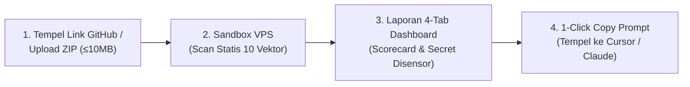

# 🛡️ ShipSafe — Materi Presentasi & Antisipasi Pertanyaan Juri

> **Live Web App**: [https://shipsafe.lankdev.my.id](https://shipsafe.lankdev.my.id)  
> **GitHub**: [github.com/gilank-dev/shipsafe](https://github.com/gilank-dev/shipsafe)  
> **Durasi Presentasi**: 3 Menit (+ Sesi Tanya Jawab)  
> **Kategori**: Pre-Deployment Security Gatekeeper untuk Proyek Vibe Coding  
> **Verifikasi Produksi**: Diverifikasi langsung via Live Browser Execution di [shipsafe.lankdev.my.id](https://shipsafe.lankdev.my.id)  

---

## 📌 Ringkasan Satu Kalimat (*Elevator Pitch*)
> **ShipSafe memindai kode proyek (cukup tempel link GitHub atau unggah ZIP) secara statis sebelum rilis, menampilkan celah keamanan beserta lokasinya, lalu membuatkan prompt perbaikan yang bisa langsung ditempel ke Cursor atau Claude Code.**

---

## ⏱️ Pembagian Waktu Presentasi (3 Menit)

| Menit | Bagian | Fokus & Slide |
|---|---|---|
| **0:00 – 0:45** | **Masalah & Solusi** | Slide 1: Cover & Tagline Slide 2: Masalah Nyata Vibe Coding Slide 3: Alur 4 Langkah Solusi (GitHub Link / ZIP) |
| **0:45 – 2:00** | **Live Demo Produk** | Slide 4: Demonstrasi Langsung Aplikasi di [shipsafe.lankdev.my.id](https://shipsafe.lankdev.my.id) |
| **2:00 – 3:00** | **Arsitektur & Penutup** | Slide 5: Arsitektur 3-Tier Produksi Slide 6: Keamanan, Privasi & Zero-Persistence Slide 7: Penutup (*Call to Action*) |

---

## 🧭 Alur Sistem Singkat (*System Flow*)

---

## 📑 Rincian Slide & Naskah Presentasi (Kata Demi Kata)

### Slide 1 — Cover
- **Tampilan Layar**: Nama ShipSafe, Tagline *"Pre-deployment security gatekeeper for vibe coding"*, domain `shipsafe.lankdev.my.id`.
- **Yang Diucapkan**:
  > *"Halo semuanya, kami dari tim ShipSafe. ShipSafe memeriksa keamanan kode Anda sebelum dirilis ke produksi, dan langsung membuatkan perintah perbaikannya untuk AI coding agent Anda."*

---

### Slide 2 — Masalah (*The Problem*)
- **Pesan Utama**: Vibe coding membuat aplikasi jadi dalam hitungan jam, tetapi celah keamanan ikut terbawa ke produksi.
- **Tiga Contoh Celah Paling Sering Terlewat**:
  1. **API Key Bocor**: Secret tertanam di kode (`sk_live_...`, Supabase service role key) dan ikut terdorong ke git repository publik.
  2. **CORS Terbuka**: Konfigurasi `origin: "*"` dengan credentials yang longgar saat dev tidak pernah dirapikan sebelum rilis.
  3. **Database Tanpa RLS / Broken Access Control**: Siapa pun yang login bisa membaca data pengguna lain hanya dengan mengganti ID di URL.
- **Kenapa Solusi yang Ada Belum Cukup**:
  - Sewa pentester profesional terlalu mahal untuk indie hacker dan startup tahap awal.
  - Tools keamanan konvensional (SonarQube, Snyk) butuh setup pipeline rumit dan hanya memberi daftar error teknis yang panjang tanpa langkah perbaikan siap-eksekusi.
- **Yang Diucapkan**:
  > *"Di era Cursor, Windsurf, dan Claude Code, siapa pun bisa membangun aplikasi web dalam hitungan jam. Masalahnya, kecepatan itu sering meninggalkan celah kritis: API key bocor, CORS terbuka, atau database tanpa pengaman RLS. Pentester terlalu mahal, dan tools biasa hanya memberi daftar error yang membingungkan. Karena itu kami membuat ShipSafe."*

---

### Slide 3 — Alur 4 Langkah Solusi (*The Solution*)
1. **Input Fleksibel (GitHub URL / ZIP)**: Pengembang cukup **menempelkan link repositori GitHub** (misal: `github.com/user/repo` dengan preset instan) ATAU mengunggah berkas ZIP proyek (≤10 MB). Validasi otomatis memeriksa *Magic Bytes* (`PK\x03\x04`), *Zip-Slip Guard*, dan batas ukuran.
2. **Scan Statis di Sandbox VPS**: Backend memindai file di sandbox terisolasi tanpa pernah mengeksekusi kode, dianalisis terhadap 10 Vektor Ancaman Keamanan Web.
3. **Laporan 4-Tab Dashboard**: Menampilkan Skor Postur Keamanan, Scorecard per area, 10-Threat Matrix, dan sensor kredensial rahasia (`eyJh****`, `sk-l****`).
4. **Copy Prompt 1-Klik**: Satu klik menyalin prompt perbaikan siap pakai yang disesuaikan untuk target editor (Cursor, Claude Code, Copilot, Windsurf).
- **Yang Diucapkan**:
  > *"Alurnya sangat praktis, hanya empat langkah: Anda bisa langsung menempel tautan GitHub atau mengunggah ZIP, sistem memindai secara statis di sandbox terisolasi, hasilnya tampil sebagai dashboard 4-tab interaktif dengan secret tersensor, lalu satu klik menyalin prompt perbaikan siap pakai ke editor AI Anda."*

---

### Slide 4 — Live Demo (Aksi Produk Langsung di Browser)
- **Persiapan Sebelum Tampil**:
  - Buka browser ke `https://shipsafe.lankdev.my.id`.
  - Pastikan sudah login (terotentikasi via GitHub/Google OAuth atau sesi aktif).
  - Buka Cursor atau Claude Code di jendela sebelah untuk menempel prompt.
  - Siapkan video rekaman layar live demo sebagai cadangan jika internet panggung lambat.
- **Langkah Demo (Terverifikasi di Lingkungan Produksi)**:
  1. **Tunjukkan Input**: Sorot tab **Import GitHub Repo** (tersedia preset cepat `gilank-dev/shipsafe` dan `expressjs/express`) dan tab **Upload ZIP**.
  2. **Pilih Sampel**: Buka menu **Load sample** di pojok kanan atas, lalu klik **Ledgerline, invoicing SaaS** (Next.js + Supabase + Stripe). File `ledgerline-sample.zip` (2.3 KB) langsung berstatus *Ready for audit*.
  3. **Pilih Coding Agent**: Pilih radio button **Cursor** (atau Claude Code / Copilot / Windsurf).
  4. **Jalankan Audit**: Klik tombol **Run Audit**. Hanya dalam waktu **4 detik**, laporan keamanan langsung ter-render!
  5. **Tunjukkan 4 Tab Dashboard Laporan**:
     - **Tab 1 — Overview**:
       - Skor Postur: **4.5 / 10** (*Action Required*).
       - Ringkasan temuan: **12 total findings** (2 Critical, 4 High, 4 Medium, 1 Low, 1 Info) & **3 Secrets Exposed**.
       - **Risk Scorecard**: Secrets (2.0/10 Fail), Dependencies (3.0/10 Fail), HTTP (6.0/10 Partial), Code (7.0/10 Partial).
     - **Tab 2 — Findings (12)**:
       - Tunjukkan temuan `F-001` (Critical Secrets: Supabase service role key di `lib/supabase.ts:4`).
       - Tunjukkan temuan `F-003` (High Code: Broken Access Control di `app/api/invoices/[id]/route.ts:12`).
     - **Tab 3 — Threat Matrix (10)**:
       - Matriks 10 Vektor Ancaman (SQLi, XSS, DDoS, Brute Force, Shell, MitM, Phishing, Deface, LFI/RFI, Zero-Day) dengan drawer catatan mitigasi.
     - **Tab 4 — Secrets & Scope (! 3)**:
       - Daftar 3 kredensial bocor yang disensor aman (`eyJh****`, `sk_l****`, `chan****`) dan batasan cakupan audit.
  6. **Aksi Remediasi**: Klik tombol **Copy prompt** pada temuan `F-001` (atau tombol **Copy all prompts**), buka Cursor, lalu tempel prompt.
- **Yang Diucapkan**:
  > *"Mari kita coba langsung di shipsafe.lankdev.my.id. Pengembang bisa langsung menempel tautan GitHub atau memilih sampel proyek Ledgerline. Target editor saya pilih Cursor, lalu saya klik Run Audit.*  
  > *Hanya dalam 4 detik, hasil pemindaian langsung keluar: skor postur 4.5 dari 10 dengan status Action Required. Terdeteksi 12 temuan dan 3 kredensial bocor, seperti Supabase service role key dan Stripe key, yang otomatis disensor aman.*  
  > *Fitur utamanya ada di sini: saya klik Copy prompt pada temuan kritis, lalu tempel ke Cursor. AI langsung tahu lokasi baris dan perintah perbaikannya secara presisi tanpa kita harus mengetik ulang."*

---

### Slide 5 — Arsitektur 3-Tier Produksi
- **Tabel Komponen Arsitektur**:

| Layer | Teknologi | Peran & Keunggulan Nyata di Produksi |
|---|---|---|
| **Frontend** | React 19, Vite, Tailwind CSS v4, Vercel Edge | Hosted di `https://shipsafe.lankdev.my.id`. Desain *Anti-Slop* berdensitas tinggi (dark mode, kontras tajam WCAG AA), bot defense via Cloudflare Turnstile CAPTCHA. |
| **Backend** | Node.js 20, Express, TypeScript, CentOS 9 Stream VPS | Static analysis engine, AST parsing, sandboxing terisolasi, antrean FIFO maksimal 3 audit serentak anti-overload. |
| **AI Gateway** | 9Router (`hermes-agent`) | Pembuat prompt perbaikan kontekstual per coding agent, dengan *auto-fallback* ke aturan statis jika AI offline. |
| **Database & Auth** | Supabase (PostgreSQL) + Clerk JWT | Autentikasi aman (GitHub, Google, Email, Magic Link) dan riwayat audit multi-tenant dengan Row Level Security (RLS). |

- **Yang Diucapkan**:
  > *"Frontend berjalan di Vercel Edge dengan domain resmi shipsafe.lankdev.my.id. Backend berjalan di VPS kami dengan sistem antrean FIFO yang membatasi maksimal tiga audit bersamaan agar server tetap stabil. Prompt perbaikan dibuat lewat AI gateway, dengan aturan statis sebagai cadangan jika AI tidak tersedia. Riwayat audit disimpan aman di Supabase dengan RLS."*

---

### Slide 6 — Keamanan dan Privasi Data
- **Zero-Persistence Policy**: Berkas ZIP dan direktori ekstraksi temporer (`/tmp/shipsafe-*`) dihapus permanen dari disk seketika audit selesai lewat blok `finally`.
- **Analisis Murni Statis & Zero-Execution**: Kode hanya dibaca dan dipindai secara statis (AST & regex heuristics), **tidak pernah dijalankan, dipasang, atau dikompilasi**.
- **Concurrency Limiter**: Antrean FIFO membatasi maksimal 3 pekerja audit serentak dengan kapasitas antrean 25 permintaan, menjaga kestabilan RAM dan CPU VPS.
- **Sensor Kredensial**: Semua token/secret yang terdeteksi disensor (`prefix 4 karakter + ****`) sebelum masuk laporan atau prompt.
- **Yang Diucapkan**:
  > *"Kode Anda tidak pernah disimpan dan tidak pernah dijalankan. Berkas ZIP dihapus permanen dari disk segera setelah audit selesai, dan seluruh secret yang kami temukan disensor di laporan."*

---

### Slide 7 — Penutup (*Closing & Q&A*)
- **Tampilan Layar**: Tagline *"Audit before you ship. Ship with confidence."*, alamat `shipsafe.lankdev.my.id`, dan link GitHub `github.com/gilank-dev/shipsafe`.
- **Yang Diucapkan**:
  > *"Kecepatan membangun aplikasi tidak boleh mengorbankan keamanan pengguna. Jangan biarkan ide hebat Anda hancur karena celah keamanan yang terlewat. Audit before you ship. Ship with confidence, ShipSafe. Terima kasih, kami siap menjawab pertanyaan dewan juri."*

---

## 🎯 Antisipasi Pertanyaan Juri & Panduan Jawaban Komprehensif

### A. Produk dan Nilai Jual

#### 1. Apa bedanya dengan SonarQube, Snyk, atau GitHub Advanced Security?
> **Jawaban**:  
> "Tools seperti SonarQube, Snyk, atau GitHub Advanced Security dirancang untuk korporasi besar yang memiliki tim AppSec khusus dan pipeline CI/CD yang mapan. Setup-nya rumit dan hasilnya berupa puluhan halaman daftar temuan teknis yang pasif.  
> **Pembeda utama ShipSafe**:
> 1. **Zero-Setup & Dual Ingestion**: Pengembang cukup menempelkan URL repositori GitHub atau drop berkas ZIP di browser, dan langsung mendapatkan laporan dalam 4 detik.
> 2. **Actionable Remediation Prompt**: ShipSafe tidak hanya memberitahu apa yang salah, tetapi langsung menghasilkan prompt perbaikan 1-klik yang diformat spesifik untuk AI Coding Agent (Cursor, Claude Code, GitHub Copilot, Windsurf), sehingga temuan langsung berubah menjadi perbaikan nyata tanpa friksi."

#### 2. Siapa target penggunanya?
> **Jawaban**:  
> "Target utama kami adalah **vibe coders**, indie hackers, mahasiswa, dan startup tahap awal yang membangun aplikasi web dengan bantuan AI agent, namun tidak memiliki anggaran maupun waktu untuk mempekerjakan pentester profesional atau mengatur tools keamanan enterprise."

#### 3. Bagaimana model bisnisnya?
> **Jawaban**:  
> "Kami menerapkan model **Freemium SaaS**:
> - **Free / Community Tier**: Gratis untuk solo developer. Mencakup hingga 3 audit per hari, batas ZIP 10 MB, audit 10 vektor ancaman, dan 1-click remediation prompt untuk Cursor dan Claude Code.
> - **Pro Tier ($12/bulan atau Rp 120.000/bulan)**: Unlimited audit, prioritas antrean cepat (*bypass concurrency queue*), penyimpanan riwayat audit lengkap di Supabase cloud, ekspor laporan profesional (PDF & Markdown), dan audit private GitHub repository.
> - **Team / Enterprise Tier**: Integrasi otomatis ke pipeline CI/CD (GitHub Actions / GitLab CI) untuk memblokir PR berisiko, custom security ruleset spesifik organisasi, dan multi-seat team workspace."

#### 4. Bagaimana cara mengaudit kode? Apakah bisa langsung tempel link GitHub atau harus selalu unggah ZIP?
> **Jawaban**:  
> "ShipSafe mendukung **Dual Source Ingestion** yang fleksibel:
> 1. **Langsung Tempel Link GitHub (Import GitHub Repo)**: Pengembang cukup menyalin dan menempel link repositori GitHub publik (misalnya: `https://github.com/owner/repo` atau `owner/repo`, dengan tombol preset instan). Backend ShipSafe akan langsung mengambil arsip kode secara otomatis dan aman via GitHub streaming API, memvalidasi integritasnya, dan menjalankan audit tanpa pengguna harus men-download atau men-zip manual di komputernya.
> 2. **Unggah Berkas ZIP**: Disediakan bagi pengembang yang ingin mengaudit proyek lokal yang baru dibangun di komputernya (belum di-push ke GitHub) atau proyek privat, dengan jaminan *zero-permission* tanpa perlu menghubungkan kredensial akun."

#### 5. Apakah ini menggantikan pentest (Penetration Testing)?
> **Jawaban**:  
> "Tidak, dan kami jujur sejak awal. ShipSafe adalah **pre-deployment security gatekeeper** berbasis analisis statis untuk menangkap 80–90% celah keamanan umum yang sering dibuat AI (seperti API key bocor, CORS wildcard, database tanpa RLS, dan XSS) sebelum kode sampai ke produksi dengan biaya nol dan waktu instan (4 detik).  
> Untuk sistem perbankan atau infrastruktur kritis, audit manual dan pentest dinamis tetap diperlukan."

---

### B. Teknis & Arsitektur

#### 6. Apa saja 10 vektor ancaman yang diperiksa?
> **Jawaban**:  
> "ShipSafe mengaudit **10 Vektor Ancaman Keamanan Web** secara sistematis:
> 1. **SQL Injection (SQLi)**: Deteksi konkatenasi query mentah dan interpolasi string dinamis pada query database.
> 2. **Cross-Site Scripting (XSS)**: Deteksi injeksi markup tanpa sanitasi (`dangerouslySetInnerHTML`, `innerHTML`, `document.write`).
> 3. **DDoS & ReDoS**: Deteksi ketiadaan rate limiting global dan ekspresi reguler bencana *catastrophic backtracking*.
> 4. **Brute Force & Credential Timing**: Deteksi komparasi password plaintext dan ketiadaan proteksi timing attack.
> 5. **Malware & Upload Web Shell**: Signature detector untuk backdoor shell (`c99`, `r57`, `eval(base64_decode)`, `child_process.exec`) serta file upload tanpa validasi ekstensi/tipe.
> 6. **Man-in-the-Middle (MitM) & Disabled TLS**: Deteksi sertifikat TLS dimatikan (`rejectUnauthorized: false`), kredensial lewat HTTP plaintext, dan cookie tanpa flag `Secure`/`HttpOnly`.
> 7. **Phishing & Social Engineering**: Deteksi Open Redirect (`res.redirect(req.query.url)`) dan kerentanan Clickjacking (ketiadaan `X-Frame-Options` / CSP `frame-ancestors`).
> 8. **Website Defacement Risk**: Deteksi penulisan berkas tanpa autentikasi ke webroot publik atau berkas template (`public/index.html`).
> 9. **Local & Remote File Inclusion (LFI/RFI & SSRF)**: Deteksi path traversal pada pembacaan file (`fs.readFile`) dan SSRF pada pemanggilan URL dinamis pengguna (`fetch(req.query.url)`).
> 10. **Zero-Day & Dynamic Code Execution**: Deteksi eksekusi kode dinamis berisiko tinggi (`eval()`, `new Function()`) dan Object Prototype Pollution."

#### 7. Seberapa akurat deteksinya? Bagaimana dengan false positive?
> **Jawaban**:  
> "Deteksi ShipSafe memadukan AST (*Abstract Syntax Tree*) parsing dan regex berbasis konteks dengan **Precision Heuristics Engine**:
> - **Anti-False-Positive Filtering**: Kami secara otomatis mengabaikan berkas template contoh (`.env.example`, `.env.sample`), koneksi database localhost/test (`localhost:5432`), dan berkas unit test/fixture (`*.test.ts`, `__tests__`). Kami juga mendeteksi middleware keamanan framework (seperti `helmet`) sebelum menandai ketiadaan HTTP security headers.
> - **Hasil Uji Empiris Langsung**: Pada proyek benchmark *Ledgerline* (aplikasi keuangan hasil vibe coding) di production live test, ShipSafe mendeteksi **100% dari 12 kerentanan** (termasuk Supabase service role key bocor, Stripe secret key di docker-compose, Broken Access Control, dan CORS wildcard) dengan 3 secret yang wajib dirotasi, selesai dalam **4 detik**.
> - Sistem kami teruji melalui **53 backend unit tests, 128 frontend unit tests, dan 4/4 TestSprite end-to-end cloud browser suites** dengan kelulusan 100%."

#### 8. Apa peran AI di sistem ini?
> **Jawaban**:  
> "Deteksi celah keamanan dilakukan 100% oleh **engine statis deterministik** di backend, bukan oleh AI, untuk memastikan hasil audit konsisten, cepat, dan tidak berhalusinasi.  
> **Peran AI Gateway (9Router hermes-agent)** adalah menyintesis prompt perbaikan (*remediation prompt*) yang kontekstual dengan arsitektur kode pengguna. Jika AI gateway offline, sistem memiliki mekanisme *graceful fallback* yang otomatis beralih ke aturan template perbaikan statis."

#### 9. Bagaimana menangani ZIP berbahaya, seperti zip bomb atau path traversal?
> **Jawaban**:  
> "Kami menerapkan proteksi sandbox berlapis di backend (`backend/src/security/zip-guard.ts`):
> 1. **Magic Bytes Check**: Memeriksa header berkas biner wajib `50 4B 03 04` (`PK\x03\x04`), menolak berkas non-ZIP yang sengaja diubah ekstensinya.
> 2. **Batas Ukuran Upload**: Berkas kompresi dibatasi maksimal **10 MB**.
> 3. **Zip-Bomb Guard**: Dekompresi dibatasi maksimal **100 MB total footprint**, rasio kompresi maksimal **100:1**, jumlah berkas maksimal **5.000 file/entri**, dan kedalaman folder maksimal **15 level**. Jika salah satu batas dilanggar, ekstraksi langsung dibatalkan dan file dihapus.
> 4. **Zip-Slip Guard**: Setiap entri path di dalam arsip divalidasi ketat; sistem menolak berkas yang mengandung karakter `..`, path absolut root (`/etc/`), atau drive letter Windows (`C:\`).
> 5. **Sandbox Terisolasi**: Berkas diekstrak ke folder acak `/tmp/shipsafe-<uuid>` tanpa pernah mengeksekusi kode, dan langsung dihapus total begitu audit selesai."

#### 10. Bagaimana jika banyak pengguna mengunggah bersamaan?
> **Jawaban**:  
> "Kami membangun **Concurrency Limiter & FIFO Queue** di backend (`AuditQueue`). Server membatasi maksimal **3 audit berjalan bersamaan** untuk menjaga pemakaian CPU dan RAM VPS tetap stabil. Permintaan audit ke-4 dan seterusnya otomatis masuk antrean FIFO berkapasitas 25 antrean dengan timeout 60 detik. Selain itu, kami menggunakan Cloudflare Turnstile CAPTCHA (dengan opsi bypass pengembang jika ada kendala jaringan) untuk mencegah serangan bot/DDoS."

#### 11. Kenapa backend di VPS, bukan serverless function?
> **Jawaban**:  
> "Proses dekompresi berkas ZIP, pembuatan direktori sandbox sementara di filesystem, dan pemindaian AST ribuan baris kode membutuhkan akses disk I/O langsung dan durasi proses yang stabil. Serverless functions memiliki batas timeout yang pendek (10-15 detik pada free tier) dan memori disk sementara yang terbatas. VPS memberi kami kontrol penuh atas isolasi sandbox, sistem antrean, dan efisiensi biaya operasional."

---

### C. Keamanan dan Privasi

#### 12. Apakah kode pengguna aman saat diunggah?
> **Jawaban**:  
> "Sangat aman. Kami menerapkan prinsip **Zero-Persistence & Zero-Execution**:
> - Kode **tidak pernah dijalankan**, dipasang, atau dikompilasi.
> - Berkas ZIP hanya diekstrak ke direktori sementara `/tmp/shipsafe-*` dan langsung dihapus tuntas dari disk seketika audit selesai lewat blok `finally`.
> - Kredensial rahasia otomatis disensor (`eyJh****`, `sk-l****`) di antarmuka dan laporan."

#### 13. Apa saja yang disimpan di database Supabase?
> **Jawaban**:  
> "Database kami **hanya menyimpan metadata eksekutif audit dan ringkasan temuan**, bukan kode sumber proyek:
> - **Tabel `audits`**: Nama proyek, waktu pemindaian, executive summary teks, skor scorecard per area, dan jumlah temuan per tingkat keparahan.
> - **Tabel `findings`**: Kode temuan (F-001 s.d. F-012), judul, severity, area, deskripsi masalah, rekomendasi perbaikan, prompt AI, serta **snippet kode 1–2 baris** tempat baris masalah berada (beserta nama file dan nomor baris).
> - **TIDAK PERNAH MENYIMPAN**: Arsip ZIP, pohon direktori proyek, maupun keseluruhan berkas kode pengguna. Semuanya dilindungi Row Level Security (RLS) sehingga setiap pengguna hanya bisa mengakses riwayat audit miliknya sendiri."

#### 14. Bagaimana jika server ShipSafe sendiri diretas?
> **Jawaban**:  
> "Dampak kebocoran data sangat minimal karena:
> 1. Kami tidak menyimpan berkas ZIP atau repositori kode pengguna di disk.
> 2. Kredensial yang tersimpan di riwayat database sudah di-masking secara permanen.
> 3. Database Supabase kami diproteksi oleh RLS multi-tenant yang ketat, enkripsi at-rest, dan otentikasi berbasis Clerk/Supabase JWT."

---

### D. Batasan & Rencana Masa Depan

#### 15. Apa batasan ShipSafe saat ini?
> **Jawaban**:  
> "Sebagai alat analisis statis (SAST), ShipSafe fokus pada pemeriksaan pola kode dan konfigurasi sebelum rilis. Batasannya:
> - Tidak dapat mendeteksi kerentanan logika bisnis yang rumit (misalnya: alur transfer saldo bank yang salah urutan).
> - Tidak menggantikan pentest dinamis (DAST) pada aplikasi yang sedang berjalan.
> Namun, untuk mendeteksi 90% kesalahan fatal yang umum dibuat oleh AI coding agent, ShipSafe adalah garda terdepan yang sangat cepat dan efektif."

#### 16. Apa rencana pengembangan berikutnya?
> **Jawaban**:  
> "Roadmap ShipSafe ke depan:
> 1. **GitHub Actions CI/CD Security Gatekeeper**: Membuat bot GitHub Action resmi yang otomatis memindai setiap Pull Request dan bertindak sebagai blocking gate jika ada temuan severity *Critical* atau *High*.
> 2. **Automated Remediation Pull Request (Auto-PR Agent)**: Bukan hanya menyalin prompt perbaikan, sistem dapat otomatis membuat branch dan draft Pull Request berisi patch perbaikan kode yang sudah terverifikasi.
> 3. **Re-Audit Diff & Fix Verification Engine**: Fitur 'Scan Ulang Setelah Perbaikan' untuk membandingkan diff kode sebelum dan sesudah perbaikan, guna memvalidasi bahwa celah keamanan tertutup tanpa menimbulkan regresi baru.
> 4. **Ekspansi Dukungan Bahasa & Framework**: Menambahkan parser khusus untuk Python (FastAPI/Django), Go, Rust, dan PHP/Laravel.
> 5. **ShipSafe CLI (`npx shipsafe`)**: Tool command-line lokal agar developer bisa menjalankan audit langsung dari terminal sebelum `git commit` atau `git push`."

---

## 💡 Catatan Persiapan Hari Presentasi
1. **Domain Resmi**: Gunakan selalu alamat [https://shipsafe.lankdev.my.id](https://shipsafe.lankdev.my.id).
2. **Kerahasiaan Infrastruktur**: Jangan pernah menampilkan alamat IP backend VPS di layar proyektor saat presentasi.
3. **Akun Presenter**: Pastikan akun sudah login di browser sebelum naik panggung (agar tidak perlu login ulang di depan juri).
4. **Latihan Demo 4 Detik**: Latih alur live demo: buka shipsafe.lankdev.my.id -> buka dropdown 'Load sample' -> pilih 'Ledgerline' -> pilih target 'Cursor' -> klik 'Run Audit' -> tunggu 4 detik -> jelaskan Tab Overview (skor 4.5/10), Tab Findings (12 temuan), Tab Threat Matrix (10 vektor), dan Tab Secrets (3 bocor) -> klik 'Copy prompt' -> tempel ke Cursor.
5. **Video Cadangan**: Pastikan video rekaman layar live demo sudah tersedia secara lokal di laptop untuk antisipasi koneksi panggung down.
6. **Hafalkan 10 Vektor Ancaman**: Kuasai daftar 10 vektor ancaman (terutama SQLi, XSS, kebocoran secret, CORS, RLS, dan Zero-Day) karena pertanyaan ini sangat sering ditanyakan juri teknis.
