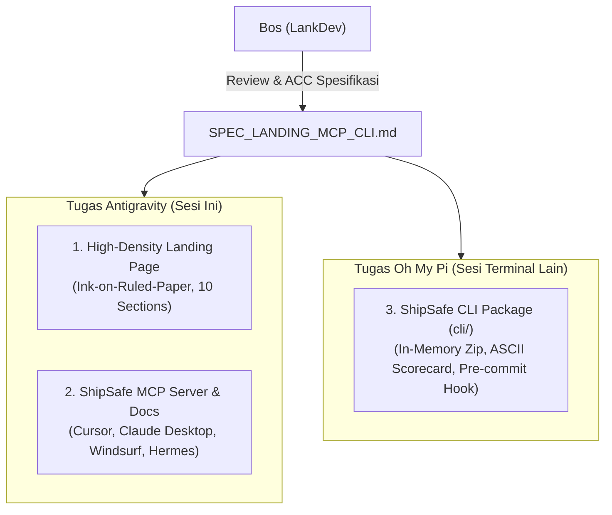

# 🛡️ ShipSafe v4 Ultra Specification: Landing Page, MCP Server, and Developer CLI

> **Document Status**: Draft Proposal — Menunggu Persetujuan Pengguna (Waiting for User ACC)  
> **Aesthetic Standard**: Ink on Ruled Paper, Rectilinear, Archivo + IBM Plex Mono (Zero Slop)  
> **Google Stitch Project**: `ShipSafe - Security Gatekeeper Landing Page` (ID: `11437311813189343935`, Screen: `79c379f43c284a0cbbb75b8569e80afc`)  
> **Screenshot Preview**: [Stitch Generated UI](https://lh3.googleusercontent.com/aida/AEtjO1V2QBQkpQJtX06p72s4YwG4bvFrH4vA5Q1g1CrE_GSbFkyAFA0xPvuF4ImZa-ZzhfI95tO6x16Z6ezpNKoPLTyUyfLjmMKkJ-QwM4zO_xFH6E6IMCoyoH_qWQ2c6hYw9OdeRubqevYLEW88k8kJe4Le5mOPU5SbuE5ywzbCxjr6DMOSwzDffgUnARMLc5lIZlSWfR_O7nguic1OQcmoIFnZZNK0x1jfhBqDGB4bSoCIfJN1h4EEONBfv4uY)

---

## 1. Pembagian Tugas Duet (Division of Responsibilities)



---

## 2. Bagian I: Spesifikasi Landing Page (Antigravity)

### 2.1 Konsep & Panduan Desain (Design System Stitch)
- **Tema**: *Customs Desk for Code* (Meja Pemeriksaan Bea Cukai Perangkat Lunak).
- **Estetika**: Kertas bergaris millimeter (*ruled paper* / grid 8px), garis batas tinta hitam pekat 2px (`#121212`), sudut lancip (`rounded-none` / radius 0px), kartu rectilinear dense.
- **Tipografi**:
  - Judul / Display: **Archivo** (Bold, condensed/grotesque, authoritative).
  - Data / Kode / Metadata / Label: **IBM Plex Mono** (Tabular figures, uppercase tracking).
- **Achromatic Palette with Semantic Signals**:
  - Substrate / Background: `#fafaf7` (archival paper) / `#0c1017` (dark mode).
  - Tinta Teks: `#121212` (light) / `#f3f4f6` (dark).
  - Sinyal Status Semantik (Hanya untuk State):
    - Hijau `#16a34a`: `PASSED INSPECTION`, `CLEAR TO SHIP`.
    - Kuning/Amber `#d97706`: `WARNING`, `MANUAL AUDIT REQUIRED`.
    - Merah `#dc2626`: `CRITICAL BREACH`, `QUARANTINED`, `CONTRABAND DETECTED`.

---

### 2.2 Struktur 10 Bagian Landing Page (Super Lengkap)

#### 1. Top Navigation Bar (TopNavBar)
- **Brand Identity**: Logo cap stempel perisai/paspor + Teks: `SHIPSAFE // CUSTOMS DESK` + Chip status: `v2.4-STABLE`.
- **Navigasi Monospace**:
  - `DOCUMENTATION` (Link ke dokumentasi spec).
  - `MCP SERVER` (Link ke section MCP & config snippet).
  - `CLI GUIDE` (Link ke panduan terminal).
  - `THREAT MATRIX` (Link ke matriks 10 ancaman).
- **Aksi Cepat**:
  - Tombol Teks `LOGIN` (Membuka Auth Modal Supabase Auth).
  - Tombol Utama `LAUNCH CONSOLE ->` (Border 2px, black fill, white text, membuka web app audit).

#### 2. Hero Section (Customs Docket & Quick Audit Terminal)
- **Header Berkas**: `MANIFEST #SS-9042 // PRE-SHIPMENT CLEARANCE`.
- **Headline Utama**: `"The Customs Desk for Vibe-Coded Web Apps. Inspect before you ship."`
- **Subheadline**: *"Dibuat khusus untuk developer yang melakukan coding dengan kecepatan prompt AI (Cursor, Claude Code, Windsurf). Cegah kebocoran service role key, rute API tanpa proteksi auth, dan celah prompt injection dalam 3 detik sebelum kode di-push ke produksi."*
- **Quick Input Bar**:
  - Kotak terminal: `npx shipsafe inspect ./my-app` + tombol `[COPY]`.
  - Tombol alternatif: `[OR DROP ZIP / GITHUB REPO URL ->]`.
- **Live Terminal Demonstration Mockup**:
  - Header: `LIVE AST TELEMETRY // TARGET: repo-vibe-saas.bundle.zip (4.8MB)` + indikator denyut hijau `[SCANNING ACTIVE]`.
  - Log interaktif:
    ```text
    [00:01.04] AST parsing 42 files... OK
    [00:01.88] Vector 01: Service keys scan... [FAIL] - Stripe secret key exposed in /api/checkout.ts:14
    [00:02.12] Vector 04: Auth middleware check... [WARN] - Missing session guard on /api/admin/metrics
    [00:02.89] Vector 07: Prompt injection surface... [FAIL] - Raw unsanitized user query passed to OpenAI client
    [00:03.00] MANIFEST STATUS: SHIPMENT QUARANTINED (2 Critical, 1 Warning)
    ```
  - Tab Switcher: Tab 1 `[INSPECTION REPORT]` dan Tab 2 `[1-CLICK REMEDIATION PROMPT]`.

#### 3. Use Case Riil (3 Rectilinear Blueprint Cards)
- **01. Solo Vibe Coders**:
  *Konteks*: Menulis ribuan baris kode dengan AI tanpa latar belakang spesialisasi keamanan siber.
  *Solusi*: ShipSafe mendeteksi impor pustaka yang dihalusinasi AI, kebocoran token database, dan miskonfigurasi CORS sebelum proyek Anda diluncurkan di Twitter / Product Hunt.
- **02. Indie Hackers Shipping SaaS**:
  *Konteks*: Membangun SaaS cepat menggunakan Next.js + Supabase + Stripe.
  *Solusi*: Memvalidasi bahwa verifikasi webhook Stripe tidak di-bypass, Row Level Security (RLS) Supabase aktif dan mencegah cross-tenant data leak, serta cookie session memiliki flag `HttpOnly; Secure`.
- **03. Fast Engineering Teams**:
  *Konteks*: Tim rintisan yang ingin kecepatan tanpa mengorbankan kualitas rilis.
  *Solusi*: Dipasang sebagai GitHub Action atau pre-commit hook lokal untuk memblokir Pull Request yang mengandung celah kritis sebelum merger ke branch `main`.

#### 4. Kemudahan Penggunaan (The 3-Second Protocol)
- **Langkah 1 (Zero Daemons / Config)**: Tidak perlu menulis 200 baris file konfigurasi YAML rumit seperti SonarQube. Cukup jalankan `npx shipsafe`, masukkan link GitHub, atau drop berkas ZIP.
- **Langkah 2 (3-Second AST Parsing)**: Pemindaian statis AST langsung di memori RAM terisolasi dengan kecepatan rata-rata 3–4 detik. Bebas risiko eksekusi kode jahat.
- **Langkah 3 (Instant Verdict Stamp & Prompts)**: Langsung mendapatkan stempel putusan jelas (`PASSED` atau `ACTION REQUIRED`) lengkap dengan prompt perbaikan 1-klik untuk AI agent Anda.

#### 5. Kelebihan & Kekuatan Unik (Strengths)
- **10 Vektor Ancaman Terinspeksi**:
  1. Hardcoded API & Service Keys (OpenAI, Stripe, AWS, Resend).
  2. Insecure CORS & Wildcard Origins bersama credentials.
  3. Unauthenticated API Endpoints & Leaky Middleware.
  4. Prompt Injection & Unsanitized LLM Context Surfaces.
  5. Exposed Client-Side Environment Variables (`NEXT_PUBLIC_`, `VITE_`).
  6. Direct SQL/NoSQL Injection & Insecure ORM Clauses.
  7. Vulnerable Package Imports & Typo-Squatted AI Libs.
  8. SSRF & Unbounded Fetch Endpoints.
  9. Missing Row Level Security (RLS) pada tabel multi-tenant.
  10. Dangerous Dynamic Code Execution (`eval()`, `new Function()`, `execSync`).
- **Zero-Persistence Privacy Guarantee**: Berkas hanya diproses dalam sandbox RAM sementara dan langsung dimusnahkan seketika audit selesai. Kode Anda tidak disimpan, tidak diindeks, dan tidak digunakan untuk melatih model AI.
- **1-Click Agent-Tailored Prompts**: Format prompt dibuat khusus untuk Cursor (`@fix-security`), Claude Code (`/audit-fix`), Copilot, dan Windsurf lengkap dengan nomor baris dan rekomendasi diff patch.

#### 6. Kekurangan & Batasan Jujur (Radical Transparency)
*(Disajikan dengan format stempel resmi "LIMITATIONS & BOUNDARIES", membangun kredibilitas tinggi tanpa over-promising)*:
- **Batasan 1 — Batas Arsip 10 MB**: Dirancang optimal untuk aplikasi web, microservice, dan skrip rintisan; tidak ditujukan untuk monorepo korporat raksasa berisi aset biner ratusan megabyte.
- **Batasan 2 — Purely Static Analysis (SAST)**: ShipSafe memindai struktur kode dan konfigurasi secara statis; tidak menjalankan aplikasi (*Dynamic Analysis/DAST*) atau memantau status memori runtime aktif.
- **Batasan 3 — AI-Assisted Gatekeeper, Bukan Pengganti Pentester Manusia**: ShipSafe mengeliminasi 95% kelalaian keamanan umum pengembang, namun tidak menggantikan audit sertifikasi kepatuhan manual (*SOC2 / ISO 27001 penetration test*) berbiaya puluhan juta rupiah.

#### 7. Developer Pricing & Kontak Admin Langsung
- **Tabel 3-Tier**:
  - **Community Tier ($0 / Gratis Selamanya)**:
    - 3 audit web console per hari, unlimited audit via local CLI, 10 vektor ancaman, prompt 1-klik, arsip maks 10MB.
  - **Pro Developer ($12 / bulan atau Rp 120.000)**:
    - Unlimited web & CLI audits, prioritas antrean bypass, riwayat audit Supabase tersimpan, ekspor sertifikat keamanan PDF resmi, integrasi MCP server.
  - **Enterprise / Custom (Bespoke)**:
    - On-premises Docker deployment, kustomisasi aturan keamanan organisasi, integrasi bot PR GitHub privat, faktur transfer bank / invoice perusahaan, SLA support.
- **Direct Admin Contact Box**:
  - Judul: *"Butuh aturan audit kustom, lisensi tim, atau invoice transfer bank lokal? Kontak admin inti langsung."*
  - Tombol Kontak 1: `[TALK ON WHATSAPP ->]` (Link langsung ke WhatsApp Lead: `+62 821-2415-3732` / `082124153732`).
  - Tombol Kontak 2: `[EMAIL ADMIN ->]` (Link langsung ke pure Gmail admin: `gilankdev@gmail.com`).
  - Status Badge: `● ADMIN ONLINE // RATA-RATA RESPON < 15 MENIT`.

#### 8. Review & Cerita Pengembang Nyata (Developer Testimonials)
- **Review 1 — @alex_builds (Fullstack Indie Hacker)**:
  > *"Cursor nggak sengaja menaruh Supabase service role key di dalam file `lib/supabase.ts` yang ter-bundle ke client. ShipSafe langsung teriak 'CRITICAL' dalam 3 detik pas aku coba test zip sebelum rilis. Literal penyelamat database."*
- **Review 2 — @priya_codes (AI Engineer)**:
  > *"Tools lain cuma ngasih tau 'CWE-89 SQL Injection' tanpa solusi. ShipSafe langsung bikinin prompt siap tempel buat Claude Code lengkap dengan cara sanitasi input RAG. 1 menit langsung beres."*
- **Review 3 — @marcus_t (Tech Lead)**:
  > *"Kami mengganti SonarQube yang berat dan bikin CI lelet dengan ShipSafe CLI di pre-commit hook. Tim vibe coder kami tetap ngebut tanpa bikin tim infra was-was."*

#### 9. Interactive FAQ Accordion
1. *Apa perbedaan ShipSafe dengan Snyk atau SonarQube?*
   -> Snyk dan SonarQube berfokus pada ekosistem enterprise yang lambat dan memerlukan setup pipeline rumit. ShipSafe dirancang khusus untuk era vibe-coding: instan, fokus pada celah umum LLM, dan menghasilkan prompt perbaikan per-agent yang bisa langsung dieksekusi.
2. *Apakah kode sumber saya disimpan atau diintip?*
   -> Tidak. ShipSafe menerapkan kebijakan Zero-Persistence ketat: berkas ZIP diekstrak ke direktori RAM sementara, dipindai, lalu langsung dihapus. Kode tidak pernah disimpan permanen atau dipakai untuk training model.
3. *Bagaimana cara menghubungkan ShipSafe ke Cursor atau Claude Desktop?*
   -> Cukup tambahkan ShipSafe MCP server ke konfigurasi tools Anda. AI agent Anda dapat langsung memanggil tool `audit_codebase` secara lokal.
4. *Apakah ShipSafe bisa dijalankan offline di komputer lokal?*
   -> Ya! Menggunakan ShipSafe CLI (`npx shipsafe scan`), proses bundling dilakukan lokal, dan Anda dapat mengarahkan pemindaian ke backend lokal atau cloud.

#### 10. Footer & Legal Standards
- Status Kepatuhan: `GDPR ZERO-PERSISTENCE COMPLIANT // EPHEMERAL PROCESSING // WCAG 2.1 AA CERTIFIED`.
- Link Cepat: `DOCUMENTATION`, `GITHUB REPO`, `SYSTEM HEALTH STATUS (VPS: ACTIVE)`, `TERMS OF INSPECTION`.
- Stempel Akhir: `SHIPSAFE SECURITY GATEWAY // ALL INVENTORIES CLEARED // 2026`.

---

## 3. Bagian II: Spesifikasi ShipSafe MCP Server (Antigravity)

### 3.1 Gambaran Umum MCP
ShipSafe MCP Server (`shipsafe-mcp`) mengimplementasikan spesifikasi **Model Context Protocol (MCP)** standar Anthropic/Open-Source. Memungkinkan coding agent (Cursor, Claude Desktop, Windsurf, OpenCode, Hermes) untuk:
1. Memindai proyek aktif secara mandiri tanpa keluar dari obrolan.
2. Mengetahui kelemahan keamanan secara presisi langsung dalam konteks percakapan.
3. Menerapkan patch perbaikan secara otonom (*self-healing loop*).

### 3.2 Daftar Tools MCP yang Disediakan
1. **`audit_codebase`**:
   - Parameter:
     - `path` (string, opsional: path direktori lokal yang akan diaudit, default `.`).
     - `targetAgent` (string, opsional: `'Cursor' | 'ClaudeCode' | 'Copilot' | 'Windsurf' | 'Generic'`).
   - Output: `AuditReport` ringkas dengan Skor Postur, Matriks 10 Ancaman, dan Daftar Temuan.
2. **`get_threat_matrix`**:
   - Parameter: `path` (string, opsional: path target direktori).
   - Output: Status komprehensif 10 Vektor Ancaman (`Secure`, `Warning`, `Vulnerable`).
3. **`get_remediation_prompt`**:
   - Parameter:
     - `findingId` (string, wajib: misal `'F-SEC-001'`).
     - `filePath` (string, opsional: berkas target).
     - `targetAgent` / `agent` (string: `'Cursor' | 'ClaudeCode' | 'Copilot' | 'Windsurf'`).
   - Output: Prompt perbaikan lengkap yang siap ditempel ke AI Coding Agent.
4. **`verify_fix`**:
   - Parameter:
     - Single File Mode: `filePath` (string, wajib), `findingType` (string, opsional).
     - Directory Comparison Mode: `baseDir` (string), `fixedDir` (string).
   - Output: Evaluasi diff apakah masalah telah tuntas (`ALL_RESOLVED`), sebagian (`PARTIALLY_RESOLVED`), atau memicu regresi (`REGRESSION_DETECTED`).

### 3.3 Dokumentasi Konfigurasi Klien MCP
- **Claude Desktop (`claude_desktop_config.json`)**:
  ```json
  {
    "mcpServers": {
      "shipsafe": {
        "command": "node",
        "args": ["C:/Users/HYPE AMD/files/PROJECT/PERSONAL/ShipSafe/mcp/dist/index.js"]
      }
    }
  }
  ```
- **Cursor (`.cursor/mcp.json`)**:
  ```json
  {
    "mcpServers": {
      "shipsafe": {
        "command": "node",
        "args": ["./mcp/dist/index.js"]
      }
    }
  }
  ```

---

## 4. Bagian III: Spesifikasi ShipSafe CLI di `cli/`

### 4.1 Arsitektur & Pelaksanaan CLI
Paket CLI `@lankdev/shipsafe-cli` beroperasi sebagai gatekeeper keamanan lokal dan integrasi CI/CD:
1. Menggunakan parser argumen native Node.js (`util.parseArgs`), pewarnaan ANSI escape codes murni, dan `adm-zip` untuk pemindaian remote opsional.
2. Mematuhi `.gitignore` lokal dan whitelist folder untuk menghindari pembacaan `node_modules` atau file biner.
3. Mendukung eksekusi tanpa login (audit lokal 100% anonim dan instan) serta sinkronisasi sesi akun via token console.

### 4.2 Fitur & Perintah CLI Lengkap
1. **Command `shipsafe scan [dir]`**:
   - Pengecekan statis terhadap 10 Vektor Ancaman.
   - Flag `--agent=<agent>`: Menghasilkan prompt remediasi AI langsung di docket teks terminal atau laporan markdown (`cursor`, `claudecode`, `copilot`, `windsurf`).
   - Flag `--format=<type>`: Pilihan output `text` (Customs Docket), `json`, `sarif` (SARIF 2.1.0 untuk GitHub Code Scanning), atau `markdown`.
   - Flag `--fail-on=<level>`: Ambang batas exit code 1 (`critical`, `high`, `medium`, `low`).
2. **Sinkronisasi Akun Pengguna (`login`, `whoami`, `logout`)**:
   - `shipsafe login --token=<token>`: Mengaitkan CLI ke akun pengguna Supabase Auth dan menyimpan kredensial di `~/.shipsafe/credentials.json`.
   - `shipsafe whoami`: Memeriksa email aktif dan masa berlaku token.
   - `shipsafe logout`: Menghapus kredensial tersimpan secara aman.
3. **Re-Audit Diff Command (`shipsafe diff <base> [target]`)**:
   - Membandingkan direktori sebelum perbaikan (`baseDir`) dan sesudah perbaikan (`targetDir`).
   - Melaporkan delta skor postur keamanan, daftar temuan yang tuntas ditutup, dan mendeteksi jika timbul celah regresi baru.
4. **Git Pre-Commit Hook & CI/CD**:
   - Skrip instalasi otomatis: `node scripts/install-hook.js --install`.
   - Workflow GitHub Actions siap pakai di `.github/workflows/shipsafe-gatekeeper.yml`.

---

## 5. Bagian IV: Kebijakan Super Admin Clearance & Whitelist

Untuk melindungi integritas buku besar sistem (*System-Wide Ledger*), manajemen kuota kustom, dan audit tenant cross-organization, ShipSafe memberlakukan aturan Super Admin Whitelist yang ketat di tingkat Supabase Auth:

- **Daftar Email Super Admin Terverifikasi**:
  1. `hi@lankdev.my.id`
  2. `gilankdev@gmail.com`
  3. `ghilankputraramadhan@gmail.com`
- **Tingkat Otorisasi**:
  - Hanya identitas terotentikasi yang cocok dengan salah satu dari ketiga email di atas yang dapat mengakses `/console?tab=admin` atau mengeksekusi override administratif.
  - Sesi dari email non-whitelist secara otomatis dialihkan ke interface standar dengan peringatan `[CLEARANCE: ACCESS RESTRICTED]`.
