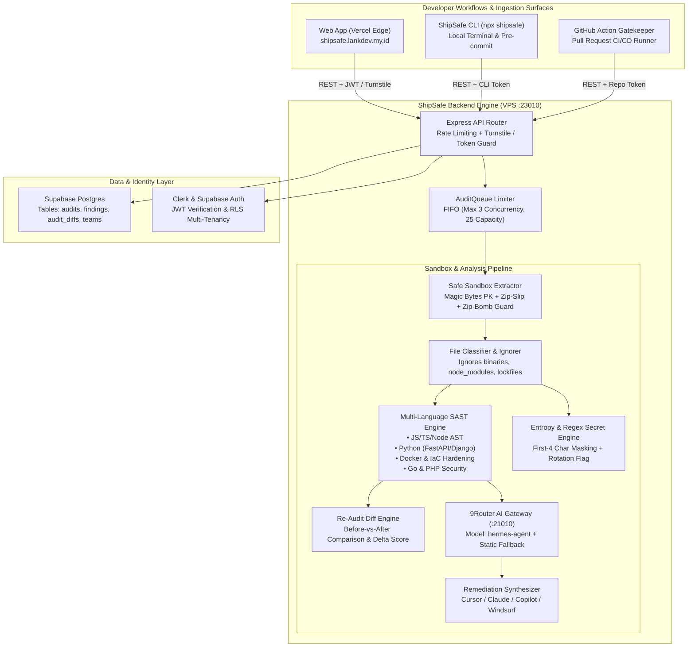
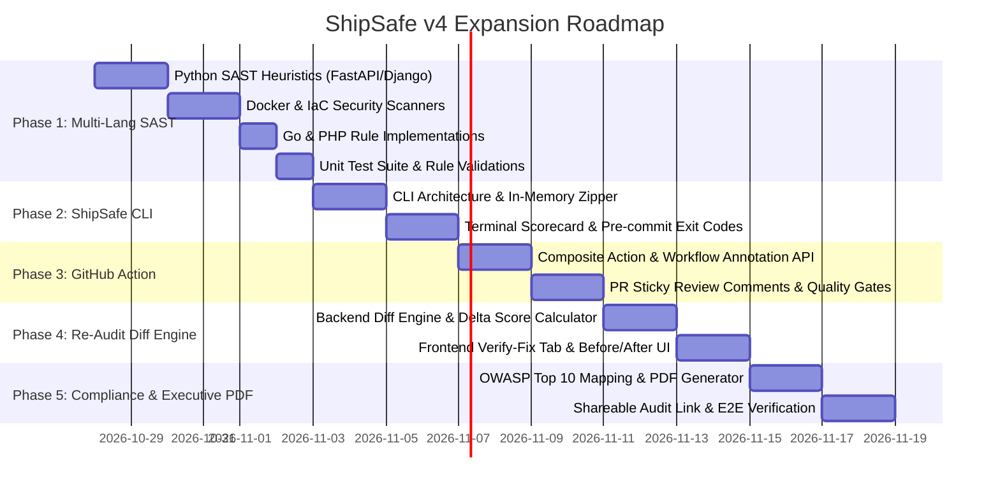

# 🛡️ ShipSafe v4 Implementation Plan (Pre-Deployment Security Gatekeeper)

> **Document Type**: Spec-to-Plan / Architectural Roadmap  
> **Mode**: `/ultra-plan` (Pre-Production Stage)  
> **Standards Compliance**: Fullstack Super Skill, Anti-Slop, OWASP ASVS Level 2, WCAG AA  
> **Target Timeline**: 5 Phased Sprints  
> **Current Test Baseline**: 192/192 Tests Passing (131 Frontend, 61 Backend)

---

## ⚠️ 0. Mandatory Invariant: Frozen UI/UX Design System (Zero Visual Drift)

> [!IMPORTANT] **Instruksi Mutlak Pengguna (LankDev - 2026-10-27)**:
> *"jangan pernah ubah design nya ya, design harus tetap seperti ini"*
>
> **Aturan Baku Desain yang Terkunci (FROZEN & IMMUTABLE):**
> 1. **Dilarang Merombak Tampilan:** Estetika antarmuka saat ini (*release-inspection form*, *ink on ruled paper*, rectilinear, zero-slop) **TIDAK BOLEH DIUBAH**.
> 2. **Tipografi Terkunci:** Wajib menggunakan font yang sudah ada: **Archivo** (variable) untuk judul/teks dan **IBM Plex Mono** untuk elemen monospaced/code. Dilarang mengganti font family.
> 3. **Design Tokens & Palette:** Wajib mematuhi `tokens.css` dan `frontend/DESIGN.md`. Dilarang menambahkan gradasi ungu/indigo, card floating dengan drop shadow lebay, sudut `rounded-2xl` acak, atau efek glassmorphism/glow.
> 4. **Tata Letak & Navigasi:** 4-Tab Dashboard (Overview, Findings, Threat Matrix, Secrets to Rotate), Upload Dropzone, Sticky Rail, dan Verdict Stamp tetap dipertahankan persis seperti sekarang.
> 5. **Integrasi Fitur Baru:** Setiap data atau fitur baru (seperti Diff Verifier di Phase 4 atau Compliance Mapping di Phase 5) **wajib menyatu ke dalam desain token dan pola komponen yang sudah ada** tanpa merusak hierarki visual yang sudah disetujui.

---

## 1. Executive Summary & Expansion Vision

ShipSafe saat ini telah sukses beroperasi sebagai pre-deployment security auditor 3-tier (Vercel Edge Frontend + CentOS 9 VPS Backend API + Supabase DB & Auth). Versi 3 telah mampu memindai berkas ZIP dan repositori GitHub terhadap 10 Vektor Ancaman (SQLi, XSS, DDoS/ReDoS, Brute Force, Web Shell, MitM, Phishing/Open Redirect, Defacement, LFI/RFI/SSRF, Zero-Day) dengan integrasi 9Router AI Gateway (`hermes-agent`) serta auto-fallback statis presisi.

**Visi Pengembangan ShipSafe v4** mentransformasi ShipSafe dari "web scanner pasif" menjadi **"End-to-End Developer Security Platform & Gatekeeper"** yang mencakup:
1. **Developer CLI (`npx shipsafe scan`)**: Memindai langsung dari terminal & pre-commit hook (Husky/lint-staged) tanpa upload manual.
2. **GitHub Action CI/CD Gatekeeper**: Blocking security gate pada Pull Request dengan komentar inline annotations langsung di tab "Files Changed".
3. **Re-Audit Diff & Fix Verification Engine**: Memvalidasi apakah perbaikan kode yang dilakukan oleh AI Agent (Cursor, Claude, Copilot) benar-benar menutup celah atau justru menimbulkan celah baru (regresi).
4. **Multi-Language SAST Expansion**: Parser heuristik cerdas untuk Python (FastAPI/Django), Go, PHP (Laravel), dan Docker/IaC.
5. **Executive Audit Report & OWASP Compliance Export**: Laporan audit standar C-level/investor dengan pemetaan OWASP Top 10 dan sertifikat verifikasi tanda tangan digital.

---

## 2. System Architecture & C4 Container Model



---

## 3. Data Model & Schema Extensions

### 3.1 Tabel Baru: `audit_diffs`
Menyimpan hasil perbandingan audit (sebelum vs sesudah perbaikan kode):
```sql
CREATE TABLE IF NOT EXISTS public.audit_diffs (
    id UUID PRIMARY KEY DEFAULT gen_random_uuid(),
    user_id UUID REFERENCES auth.users(id) ON DELETE CASCADE,
    base_audit_id UUID NOT NULL REFERENCES public.audits(id) ON DELETE CASCADE,
    target_audit_id UUID NOT NULL REFERENCES public.audits(id) ON DELETE CASCADE,
    score_before NUMERIC(3,1) NOT NULL,
    score_after NUMERIC(3,1) NOT NULL,
    score_delta NUMERIC(3,1) NOT NULL,
    resolved_findings JSONB NOT NULL DEFAULT '[]'::jsonb,
    persistent_findings JSONB NOT NULL DEFAULT '[]'::jsonb,
    regressed_findings JSONB NOT NULL DEFAULT '[]'::jsonb,
    created_at TIMESTAMPTZ NOT NULL DEFAULT timezone('utc'::text, now())
);

ALTER TABLE public.audit_diffs ENABLE ROW LEVEL SECURITY;
CREATE POLICY "Users can only view their own audit diffs"
    ON public.audit_diffs FOR SELECT
    USING (auth.uid() = user_id);
```

### 3.2 Tabel Baru: `cli_tokens`
Menyimpan token akses developer untuk integrasi CLI & GitHub Actions tanpa interaksi browser:
```sql
CREATE TABLE IF NOT EXISTS public.cli_tokens (
    id UUID PRIMARY KEY DEFAULT gen_random_uuid(),
    user_id UUID NOT NULL REFERENCES auth.users(id) ON DELETE CASCADE,
    token_hash TEXT NOT NULL UNIQUE,
    token_preview TEXT NOT NULL, -- e.g. "ss_live_****1a2b"
    label TEXT NOT NULL DEFAULT 'Default CLI Token',
    last_used_at TIMESTAMPTZ,
    expires_at TIMESTAMPTZ,
    created_at TIMESTAMPTZ NOT NULL DEFAULT timezone('utc'::text, now())
);

ALTER TABLE public.cli_tokens ENABLE ROW LEVEL SECURITY;
CREATE POLICY "Users can manage their own CLI tokens"
    ON public.cli_tokens FOR ALL
    USING (auth.uid() = user_id);
```

---

## 4. Phase-by-Phase Implementation Plan



---

### 🔹 Phase 1: Engine Hardening & Multi-Language SAST Expansion
**Tujuan**: Memperluas deteksi kerentanan di luar JS/TS mencakup Python, Docker, Go, dan PHP.

- **Task 1.1: Python Security Heuristics (`backend/src/engine/rules-scanner.ts`)**
  - **SQL Injection**: Deteksi konkatenasi string pada `cursor.execute("SELECT ... " + var)` dan raw query `text(f"...")` SQLAlchemy.
  - **Dynamic Execution / Deserialization**: Deteksi `pickle.loads()`, `eval()`, `exec()`, `marshal.loads()`, `yaml.load()` tanpa `SafeLoader`.
  - **SSRF**: Panggilan `requests.get(user_url)` atau `httpx.get(user_url)` tanpa validasi hostname/IP privat.
  - **Insecure CORS in FastAPI**: `allow_origins=["*"]` digabung dengan `allow_credentials=True`.
  - **Hardcoded Secret**: Deteksi secret di `settings.py` (`SECRET_KEY = "django-insecure-..."`) dan connection strings.

- **Task 1.2: Dockerfile & IaC Hardening**
  - **Root User Execution**: Peringatan jika Dockerfile tidak memiliki instruksi `USER <non-root>`.
  - **Insecure Base Images**: Peringatan jika memakai Node EOL (`FROM node:14`, `node:16`) atau Python EOL (`FROM python:2.7`, `python:3.7`).
  - **Missing `.dockerignore`**: Peringatan jika `COPY . .` atau `ADD . .` digunakan tanpa berkas `.dockerignore` yang mengecualikan `.env` atau `.git`.
  - **Exposed Debug Ports**: Peringatan jika mengekspos port debug Node (`9229`) atau JVM debug (`5005`).

- **Task 1.3: Go & PHP Rules**
  - **PHP**: Deteksi unescaped Blade `{!! $var !!}` (XSS), `unserialize($input)`, dan `DB::raw("WHERE id = " . $id)`.
  - **Go**: Deteksi `db.Query(fmt.Sprintf("SELECT ... %s", input))` dan penonaktifan verifikasi TLS (`InsecureSkipVerify: true`).

- **Task 1.4: Vitest Rule Test Suite**
  - Menulis test cases minimal 15 pengujian baru di `backend/src/engine/rules-scanner.test.ts` untuk memastikan 0 false negative pada sampel kode rentan dan 0 false positive pada kode aman.

---

### 🔹 Phase 2: ShipSafe CLI Tool (`@shipsafe/cli` / `npx shipsafe`)
**Tujuan**: Memberikan developer pengalaman audit 3 detik langsung dari terminal tanpa meninggalkan IDE.

- **Task 2.1: Arsitektur Paket CLI (`cli/`)**
  - Menggunakan `commander` (v12+) untuk parsing argumen:
    ```bash
    npx shipsafe scan [path] [options]
    Options:
      --api-url <url>      URL backend ShipSafe (default: https://shipsafe.lankdev.my.id/api)
      --token <token>      CLI API Token (atau via env SHIPSAFE_TOKEN)
      --fail-on <level>    Exit code 1 jika ada temuan >= level ('critical' | 'high' | 'medium')
      --target <agent>     Target AI agent ('cursor' | 'claude' | 'copilot' | 'windsurf')
      --export-prompts     Simpan prompts langsung ke ./shipsafe-prompts.md
      --json               Output mentah JSON untuk scripting pipeline
    ```

- **Task 2.2: In-Memory Zipper & Gitignore Parser**
  - Membaca `.gitignore` lokal dan memfilter direktori noise (`node_modules`, `.git`, `dist`, `.next`, `__pycache__`) secara otomatis.
  - Memaketkan berkas ke buffer ZIP in-memory (tanpa membuat file fisik temporer di folder proyek).
  - Melakukan streaming langsung ke endpoint `POST /api/audit`.

- **Task 2.3: Terminal UI & Exit Code Engine**
  - Visualisasi ASCII Box Scorecard:
    ```
    ┌────────────────────────────────────────────────────────┐
    │  🛡️  ShipSafe Security Audit — v4.0.0                  │
    ├────────────────────────────────────────────────────────┤
    │  Target: ./my-project                                  │
    │  Posture Score: 4.5 / 10  [ACTION REQUIRED]            │
    │  Findings: 2 Critical, 3 High, 1 Medium, 0 Low         │
    │  Secrets Exposed: 2 (masked: sk_l****, eyJh****)       │
    └────────────────────────────────────────────────────────┘
    ```
  - Jika parameter `--fail-on=high` diset dan ada temuan High/Critical, CLI keluar dengan `exit 1` (memblokir git commit pada Husky).

---

### 🔹 Phase 3: GitHub Action CI/CD Security Gatekeeper
**Tujuan**: Mengotomatisasi pemindaian keamanan pada setiap Pull Request GitHub sebelum digabung ke production.

- **Task 3.1: Definisi Action (`action.yml`)**
  - Action berbasis composite / node runner yang menerima input:
    - `shipsafe-token`: Token autentikasi ShipSafe.
    - `fail-on-severity`: Level severity yang menggagalkan build (`critical`, `high`, `never`).
    - `github-token`: Token GitHub untuk memposting komentar PR.

- **Task 3.2: PR Sticky Review Comment Formatter**
  - Memperbarui komentar tunggal (sticky comment) di PR yang berisi:
    - Skor keamanan komparatif.
    - Tabel ringkasan temuan per file yang diubah dalam PR.
    - Remediation prompt terlipat (*collapsed `<details>`*) yang siap disalin oleh reviewer.

- **Task 3.3: Inline Workflow Annotations (`::error` / `::warning`)**
  - Menggunakan format standar GitHub workflow command:
    ```text
    ::error file=lib/supabase.ts,line=4,title=Exposed Supabase Service Role Key::Service role key found on client-side bundle. Rotate immediately.
    ```
  - Developer langsung melihat garis merah di tab "Files Changed" Pull Request GitHub.

---

### 🔹 Phase 4: Re-Audit Diff & Fix Verification Engine ("Verify Fix" Mode)
**Tujuan**: Memastikan perbaikan yang dihasilkan coding agent benar-benar menyelesaikan masalah tanpa regresi.

- **Task 4.1: Backend Diff Algorithm (`backend/src/engine/diff-verifier.ts`)**
  - Endpoint: `POST /api/audit/verify-diff`
  - Input: `baseAuditId` + `newAuditZipBuffer` (atau `targetAuditId`).
  - Logika Komparasi:
    1. Mencocokkan temuan berdasarkan `ruleId` + `fileLocation`.
    2. Menentukan:
       - **Resolved**: Temuan yang ada di Base tapi hilang di Target (dianggap tuntas).
       - **Persistent**: Temuan yang masih tetap muncul di lokasi yang sama.
       - **Regressed / New**: Temuan yang sebelumnya tidak ada di Base namun muncul di Target.
    3. Menghitung Delta Skor Postur: `Score(Target) - Score(Base)`.

- **Task 4.2: Frontend Verify-Fix View (`frontend/src/components/diff/AuditDiffView.tsx`)**
  - Menambahkan sub-navigasi / mode "Verify Fix" di Report Dashboard:
    - Kartu ringkasan kemajuan: "🎉 5 Masalah Tuntas (+3.5 Poin), ⚠️ 1 Masalah Masih Ada, 🛑 0 Regresi Baru".
    - Badge visual hijau `RESOLVED` dengan timestamp verifikasi.
    - Export "Remediation Verification Certificate" dalam bentuk Markdown untuk catatan commit/PR.

---

### 🔹 Phase 5: Executive Compliance & PDF Security Report Export
**Tujuan**: Memfasilitasi kebutuhan compliance bagi tim engineering, pendiri startup, dan konsultan.

- **Task 5.1: Pemetaan OWASP Top 10 & CWE**
  - Setiap temuan (`Finding`) dipetakan ke taksonomi resmi:
    - `A01:2021-Broken Access Control` (CWE-862)
    - `A02:2021-Cryptographic Failures` (CWE-798, CWE-327)
    - `A03:2021-Injection` (CWE-89, CWE-79)
    - `A05:2021-Security Misconfiguration` (CWE-16)
    - `A07:2021-Identification and Authentication Failures` (CWE-287)
  - Ditampilkan dalam tab baru "Compliance" pada dashboard frontend.

- **Task 5.2: Print-Ready & PDF Export View**
  - Menggunakan stylesheet cetak CSS `@media print` murni (zero-dependency, anti-slop, resolusi vektor tajam) dengan tata letak laporan keamanan resmi:
    - Cover Page: Judul Proyek, Tanggal Audit, Hash Commit/Archive, Auditor ID.
    - Executive Summary & Posture Scorecard.
    - Discovered Secrets & Mandatory Rotation Checklist.
    - Detailed Vulnerability Breakdown & Code Line Snippets.
    - Verified Sign-Off Box.

---

## 5. Risk Analysis & Mitigation Matrix

| Risiko Teknis / Operasional | Dampak | Probabilitas | Strategi Mitigasi Teruji |
|---|---|---|---|
| **Peningkatan Beban Komputasi VPS** akibat aturan SAST multi-bahasa yang lebih banyak | Sedang | Rendah | Pertahankan batas ukuran arsip 10 MB, token budgeting pada AST parser, dan FIFO `AuditQueue` (maks 3 proses konkuren). |
| **False Positive pada Kode Python / Go** | Tinggi | Sedang | Validasi heuristik ganda: gabungkan pola nama file (hanya parse file `.py` untuk aturan Python) dan AST context awareness. |
| **Timeout CLI pada Jaringan Lambat** | Sedang | Rendah | Chunking streaming multipart upload dan timeout konfigurasi toleran (60 detik) dengan status progress bar terminal. |
| **Bypass CAPTCHA pada Endpoint Publik** | Kritis | Rendah | Enforce mandatory token autentikasi (CLI token atau Turnstile token). Request tanpa salah satu dari keduanya ditolak HTTP 403 Forbidden. |

---

## 6. Definition of Done (DoD) & Acceptance Criteria

Setiap phase dianggap selesai dan layak rilis hanya jika memenuhi kriteria berikut:
1. **Zero Regresi**: Seluruh 192 automated unit tests yang ada (131 frontend + 61 backend) tetap lolos 100%.
2. **New Test Coverage**: Setiap rule atau endpoint baru wajib memiliki unit test pendamping dengan cakupan jalur sukses dan kegagalan (*happy & unhappy path*).
3. **Anti-Slop UI Compliance**: Seluruh komponen UI baru mematuhi standar desain (Archivo + IBM Plex Mono, zero generic gradients, WCAG AA contrast).
4. **Clean Builds**: `npm run build` dan `npm run typecheck` di frontend dan backend menghasilkan 0 error dan 0 warning.
5. **Memory Synchronization**: Catatan progres, arsitektur, dan changelog diperbarui di Obsidian Vault `04 - Projects Knowledge Base/ShipSafe.md`.
